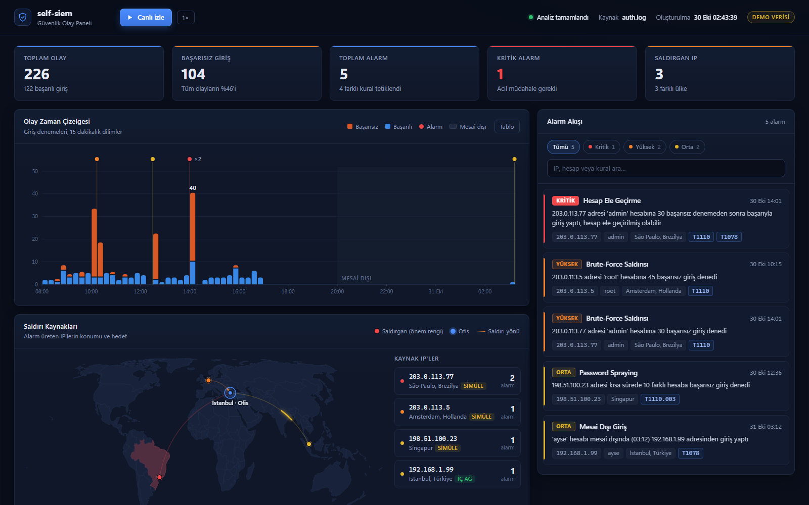
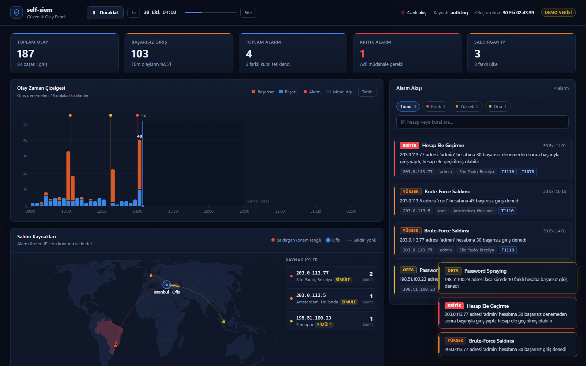
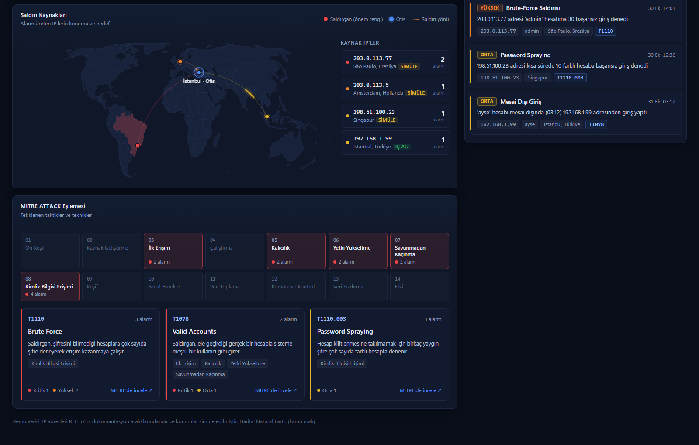
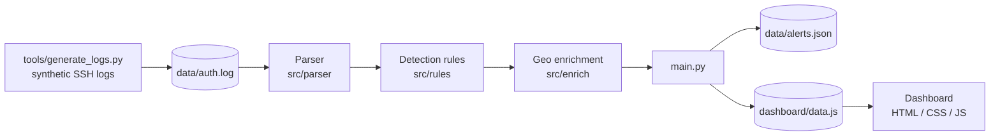

# self-siem

A small, end-to-end **SIEM (Security Information and Event Management)** built from scratch in Python
and plain HTML/CSS/JS. It parses SSH authentication logs, detects attacks with sliding-window rules
mapped to **MITRE ATT&CK**, enriches alerts with geolocation, and presents everything on a
SOC-style dashboard with a **live replay mode**.



> **Demo data.** Logs are synthetic, IP addresses come from the RFC 5737 documentation ranges
> (`203.0.113.0/24`, `198.51.100.0/24`), and attacker locations are simulated and clearly labelled as such.

---

## Why

Real SIEMs (Splunk, Microsoft Sentinel, Elastic) are large and opaque. I wanted to understand what
actually happens between "a log line is written" and "an analyst sees an alert", so I built each
stage myself: log generation, parsing, detection, enrichment, alerting and visualisation.

## Features

### Detection rules

| Rule | What it catches | Logic | MITRE ATT&CK | Severity |
|---|---|---|---|---|
| **Brute force** | Many password guesses against one account | > 10 failed logins from the same IP to the same account within 5 minutes (sliding window) | [T1110](https://attack.mitre.org/techniques/T1110/) | High |
| **Account takeover** | A brute force that *succeeded* | > 10 failed logins followed by a successful login from the same IP to the same account within 5 minutes | [T1110](https://attack.mitre.org/techniques/T1110/), [T1078](https://attack.mitre.org/techniques/T1078/) | Critical |
| **Password spraying** | A few common passwords tried across many accounts to avoid lockouts | One IP failing against > 5 *distinct* accounts within 10 minutes | [T1110.003](https://attack.mitre.org/techniques/T1110/003/) | Medium |
| **Off-hours login** | Successful login outside business hours (07:00–20:00) | Time-of-day check on successful logins | [T1078](https://attack.mitre.org/techniques/T1078/) | Medium |

Each rule is tuned to stay quiet on normal behaviour (a user mistyping their password twice must not
page anyone) and is covered by tests for both what it **should** and **should not** flag, including
boundary cases such as exactly-at-threshold.

### Dashboard

- **KPI cards**: events, failed logins, alerts, critical alerts, attacker IPs
- **Alert feed** with severity filters, search, and expandable details including a **response playbook**
  for each rule (what an analyst should do next)
- **Event timeline**: stacked 15-minute bins of successful vs failed logins, alert markers,
  off-hours shading, hover tooltips and an accessible table view
- **Attack source map**: Equal Earth projection, severity-coloured attacker points, animated arcs
  towards the office, countries tinted by their most severe alert
- **MITRE ATT&CK panel**: the 14 enterprise tactics with the ones reached by the attacker highlighted,
  plus technique cards linking to MITRE
- **Live replay**: replays the day in accelerated time. Bars grow under a playhead, alerts drop into
  the feed as they are detected, severity toasts pop up and map arcs appear

| Live replay | Map and MITRE ATT&CK |
|---|---|
|  |  |

## Architecture



1. **Parser** turns raw lines such as
   `2026-10-30 10:14:00 sshd Failed password for root from 203.0.113.5` into structured events
   using an anchored regular expression. Unrecognised lines are skipped instead of crashing the pipeline.
2. **Rules** are independent functions `events -> alerts`. Adding a rule means writing one function
   and adding it to the `RULES` list in `main.py`.
3. **Enrichment** goes through a `GeoProvider` interface. The demo uses `SimulatedGeoProvider`; a real
   deployment would plug in a MaxMind GeoLite2 reader with the same interface.
4. **Output** is written both as JSON and as `dashboard/data.js`, so the dashboard opens with a double
   click (browsers block `file://` pages from fetching local JSON, but allow loading a script).

## Quick start

Requires Python 3.10+ (developed on 3.14). The detection engine uses only the standard library.

```bash
git clone <this-repo>
cd self-siem

python tools/generate_logs.py   # writes data/auth.log (226 events, 4 attack scenarios)
python main.py                  # runs all rules, prints alerts, writes dashboard/data.js
```

Then open **`dashboard/index.html`** in a browser and press **Canlı izle** (live replay).

Analyse another log file:

```bash
python main.py --log path/to/auth.log
```

### Running the tests

```bash
python -m venv .venv
.venv\Scripts\activate          # Windows
# source .venv/bin/activate     # macOS / Linux
pip install -r requirements.txt
pytest
```

33 tests cover the parser, every detection rule, geo enrichment and the dashboard export.

## Project structure

```
self-siem/
├── main.py                  # CLI: parse -> detect -> enrich -> export
├── src/
│   ├── parser/              # SSH log line -> LogEvent
│   ├── rules/               # brute_force, account_takeover, password_spraying, off_hours_login
│   ├── enrich/              # GeoProvider interface + simulated provider
│   └── alerts/              # Alert / GeoLocation models, JSON and dashboard export
├── dashboard/               # static SOC dashboard, no dependencies
│   ├── index.html, styles.css
│   ├── app.js               # KPIs, alert feed, wiring
│   ├── timeline.js, map.js, mitre.js, replay.js
│   ├── data.js              # generated by main.py
│   └── world.js             # Natural Earth country shapes (generated)
├── tools/
│   ├── generate_logs.py     # synthetic, reproducible log generator
│   └── build_world_map.py   # shrinks Natural Earth GeoJSON (838 KB -> 151 KB)
├── tests/                   # pytest suite
└── docs/images/             # screenshots
```

## Security notes

- **XSS-safe rendering.** Log fields such as usernames are attacker-controlled. The dashboard never uses
  `innerHTML` with data; every value is inserted as a text node. This was verified by injecting an
  alert whose username and description contained `` and `<script>` payloads; they render
  as plain text.
- **No network access.** The dashboard loads no fonts, CDNs or analytics; everything is local.
  The only outbound action is a user clicking a MITRE reference link.
- **Zero runtime dependencies.** The engine uses the Python standard library; `pytest` is the only
  development dependency.
- **Explicit internal ranges.** Internal addresses are matched against RFC 1918 networks explicitly.
  Python's `ipaddress.is_private` was deliberately avoided because it also treats documentation ranges
  as private. A unit test caught this bug, which would otherwise have placed every attacker in the office.

## Limitations and roadmap

- [ ] Real GeoIP via MaxMind GeoLite2 behind the existing `GeoProvider` interface
- [ ] More log sources (firewall / web server) to enable rules such as port scanning (T1046)
- [ ] Alert correlation: merge the brute-force and takeover alerts of the same incident
- [ ] Streaming mode that tails a live log file instead of batch analysis
- [ ] Rule definitions in a declarative format (e.g. Sigma) instead of Python functions

## Credits

- Country boundaries: [Natural Earth](https://www.naturalearthdata.com/) (public domain)
- Technique and tactic references: [MITRE ATT&CK®](https://attack.mitre.org/)

## Author

Built by **[@beratssen](https://github.com/beratssen)** as a hands-on project to learn how a SIEM works
from the inside, from the first log line to the analyst's screen.

## License

[MIT](LICENSE)
