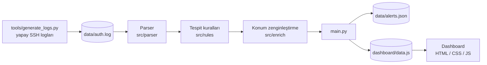

<div align="center">

# self-siem

[English](README.md) · **Türkçe**

</div>

Python ve saf HTML/CSS/JS ile sıfırdan yazılmış, küçük ama uçtan uca bir **SIEM (Security Information and
Event Management)**. SSH giriş loglarını ayrıştırır, saldırıları **MITRE ATT&CK** ile eşlenmiş kayan
pencere kurallarıyla tespit eder, alarmları konum bilgisiyle zenginleştirir ve hepsini **canlı akış
(replay) modu** olan bir SOC ekranında gösterir.

**[▶ Canlı demo](https://beratssen.github.io/self-siem/dashboard/)**: aç ve saldırı gününü yeniden oynatmak için **Canlı izle**'ye bas.


> **Demo verisi.** Loglar yapaydır, IP adresleri RFC 5737 dokümantasyon aralıklarındandır
> (`203.0.113.0/24`, `198.51.100.0/24`) ve saldırgan konumları simüle edilmiştir; arayüzde de açıkça
> böyle etiketlenir.

---

## Neden

Gerçek SIEM'ler (Splunk, Microsoft Sentinel, Elastic) büyük ve içi görünmeyen sistemler. "Bir log satırı
yazıldı" ile "analist alarmı gördü" arasında gerçekte ne olduğunu anlamak istedim; bu yüzden her aşamayı
kendim yazdım: log üretimi, ayrıştırma, tespit, zenginleştirme, alarm ve görselleştirme.

## Özellikler

### Tespit kuralları

| Kural | Ne yakalar | Mantık | MITRE ATT&CK | Önem |
|---|---|---|---|---|
| **Brute force** | Tek bir hesaba çok sayıda şifre denemesi | Aynı IP'den aynı hesaba 5 dakika içinde 10'dan fazla başarısız giriş (kayan pencere) | [T1110](https://attack.mitre.org/techniques/T1110/) | Yüksek |
| **Hesap ele geçirme** | *Başarılı olmuş* bir brute force | 5 dakika içinde aynı IP'den aynı hesaba 10'dan fazla başarısız girişin ardından başarılı giriş | [T1110](https://attack.mitre.org/techniques/T1110/), [T1078](https://attack.mitre.org/techniques/T1078/) | Kritik |
| **Password spraying** | Hesap kilitlenmesini atlatmak için birkaç yaygın şifrenin çok sayıda hesapta denenmesi | Tek bir IP'nin 10 dakika içinde 5'ten fazla *farklı* hesaba başarısız giriş denemesi | [T1110.003](https://attack.mitre.org/techniques/T1110/003/) | Orta |
| **Mesai dışı giriş** | Mesai saatleri (07:00–20:00) dışında başarılı giriş | Başarılı girişlerde saat kontrolü | [T1078](https://attack.mitre.org/techniques/T1078/) | Orta |

Her kural normal davranışta sessiz kalacak şekilde ayarlandı (şifresini iki kez yanlış yazan bir kullanıcı
kimseyi alarma geçirmemeli). Her kural, yakalaması **gereken** ve yakalamaması **gereken** durumlar için,
eşiğin tam sınırı gibi uç durumlar dahil testlerle kapsanıyor.

### Dashboard

- **KPI kartları**: olaylar, başarısız girişler, alarmlar, kritik alarmlar, saldırgan IP'ler
- **Alarm akışı**: önem derecesi filtreleri, arama ve açılabilir detaylar; her kural için analistin
  sıradaki adımlarını söyleyen bir **müdahale planı (playbook)**
- **Olay zaman çizelgesi**: başarılı ve başarısız girişlerin 15 dakikalık yığılmış sütunları, alarm
  işaretleri, mesai dışı gölgelendirme, hover ipuçları ve erişilebilir tablo görünümü
- **Saldırı kaynakları haritası**: Equal Earth projeksiyonu, önem rengindeki saldırgan noktaları, ofise
  doğru animasyonlu yaylar, en ciddi alarmlarının rengine boyanan ülkeler
- **MITRE ATT&CK paneli**: 14 kurumsal taktik ve saldırganın ulaştıkları vurgulu; MITRE'ye bağlanan
  teknik kartları
- **Canlı akış**: günü hızlandırılmış zamanda yeniden oynatır. Sütunlar bir oynatma çizgisinin arkasında
  büyür, alarmlar tespit edildikleri anda akışa düşer, önem renginde bildirimler çıkar ve haritada yaylar
  belirir

| Canlı akış | Harita ve MITRE ATT&CK |
|---|---|
|  |  |

## Mimari



1. **Parser**, `2026-10-30 10:14:00 sshd Failed password for root from 203.0.113.5` gibi ham satırları
   başı ve sonu sabitlenmiş bir düzenli ifadeyle yapılandırılmış olaylara çevirir. Tanınmayan satırlar
   programı çökertmek yerine atlanır.
2. **Kurallar**, birbirinden bağımsız `olaylar -> alarmlar` fonksiyonlarıdır. Yeni bir kural eklemek, tek
   bir fonksiyon yazıp `main.py` içindeki `RULES` listesine eklemek demektir.
3. **Zenginleştirme**, bir `GeoProvider` arayüzü üzerinden çalışır. Demo `SimulatedGeoProvider` kullanır;
   gerçek bir kurulumda aynı arayüzle bir MaxMind GeoLite2 okuyucusu takılır.
4. **Çıktı** hem JSON hem `dashboard/data.js` olarak yazılır; böylece dashboard çift tıklayınca açılır
   (tarayıcılar `file://` sayfalarının yerel JSON okumasını engeller ama script yüklemesine izin verir).

## Hızlı başlangıç

Python 3.10+ gerekir (3.14 ile geliştirildi). Tespit motoru sadece standart kütüphaneyi kullanır.

```bash
git clone https://github.com/beratssen/self-siem.git
cd self-siem

python tools/generate_logs.py   # data/auth.log dosyasını yazar (226 olay, 4 saldırı senaryosu)
python main.py                  # tüm kuralları çalıştırır, alarmları yazdırır, dashboard/data.js üretir
```

Ardından **`dashboard/index.html`** dosyasını tarayıcıda aç ve **Canlı izle**'ye bas.

Başka bir log dosyasını analiz etmek için:

```bash
python main.py --log yol/auth.log
```

### Testleri çalıştırma

```bash
python -m venv .venv
.venv\Scripts\activate          # Windows
# source .venv/bin/activate     # macOS / Linux
pip install -r requirements.txt
pytest
```

33 test; parser'ı, her tespit kuralını, konum zenginleştirmeyi ve dashboard çıktısını kapsar.

## Proje yapısı

```
self-siem/
├── main.py                  # CLI: ayrıştır -> tespit et -> zenginleştir -> dışa aktar
├── src/
│   ├── parser/              # SSH log satırı -> LogEvent
│   ├── rules/               # brute_force, account_takeover, password_spraying, off_hours_login
│   ├── enrich/              # GeoProvider arayüzü + simüle sağlayıcı
│   └── alerts/              # Alert / GeoLocation modelleri, JSON ve dashboard çıktısı
├── dashboard/               # statik SOC ekranı, bağımlılık yok
│   ├── index.html, styles.css
│   ├── app.js               # KPI'lar, alarm akışı, bağlantılar
│   ├── timeline.js, map.js, mitre.js, replay.js
│   ├── data.js              # main.py tarafından üretilir
│   └── world.js             # Natural Earth ülke şekilleri (üretilmiş)
├── tools/
│   ├── generate_logs.py     # yapay ve tekrarlanabilir log üretici
│   └── build_world_map.py   # Natural Earth GeoJSON'u küçültür (838 KB -> 151 KB)
├── tests/                   # pytest test seti
└── docs/images/             # ekran görüntüleri
```

## Güvenlik notları

- **XSS'e karşı güvenli çizim.** Kullanıcı adı gibi log alanları saldırganın kontrolündedir. Dashboard
  veriyi asla `innerHTML` ile basmaz; her değer metin düğümü olarak eklenir. Bu, kullanıcı adında ve
  açıklamasında `` ve `<script>` yükleri olan bir alarm eklenerek doğrulandı; düz metin
  olarak görünürler.
- **Ağ erişimi yok.** Dashboard hiçbir font, CDN veya analiz scripti yüklemez; her şey yereldir.
  Dışarıya giden tek işlem, kullanıcının bir MITRE bağlantısına tıklamasıdır.
- **Çalışma zamanı bağımlılığı yok.** Motor Python standart kütüphanesini kullanır; tek geliştirme
  bağımlılığı `pytest`'tir.
- **İç ağ aralıkları açıkça tanımlı.** İç adresler RFC 1918 ağlarıyla açıkça karşılaştırılır. Python'un
  `ipaddress.is_private` özelliği bilerek kullanılmadı, çünkü dokümantasyon aralıklarını da özel sayar.
  Bu hatayı bir birim testi yakaladı; yakalanmasaydı tüm saldırganlar ofiste görünecekti.

## Sınırlamalar ve yol haritası

- [ ] Mevcut `GeoProvider` arayüzü üzerinden MaxMind GeoLite2 ile gerçek GeoIP
- [ ] Port tarama (T1046) gibi kurallar için daha fazla log kaynağı (firewall / web sunucusu)
- [ ] Alarm korelasyonu: aynı olaya ait brute force ve ele geçirme alarmlarını birleştirme
- [ ] Toplu analiz yerine canlı bir log dosyasını izleyen akış modu
- [ ] Kuralların Python fonksiyonları yerine bildirimsel bir formatta (ör. Sigma) tanımlanması

## Kaynaklar

- Ülke sınırları: [Natural Earth](https://www.naturalearthdata.com/) (kamu malı)
- Teknik ve taktik referansları: [MITRE ATT&CK®](https://attack.mitre.org/)

## Yazar

**[@beratssen](https://github.com/beratssen)** tarafından, bir SIEM'in ilk log satırından analistin
ekranına kadar içeriden nasıl çalıştığını öğrenmek için uygulamalı bir proje olarak geliştirildi.

## Lisans

[MIT](LICENSE)
